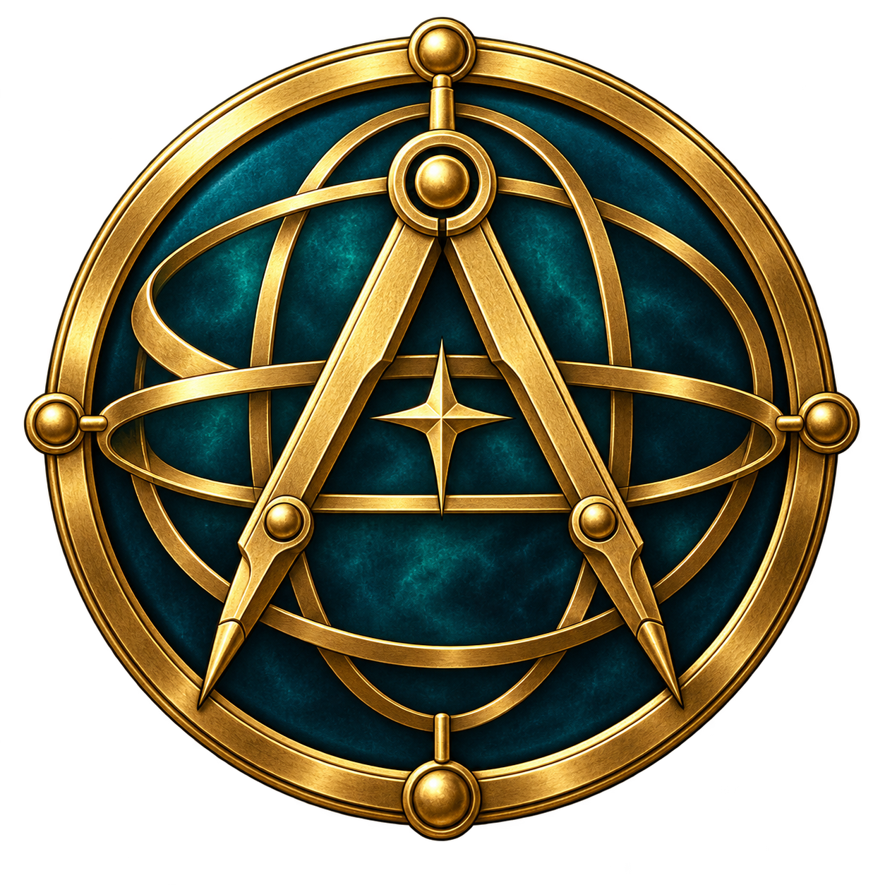

# Noble Archimedes

**Latest beta: [v0.9.7c](https://github.com/sergiomanzur/noble-archimedes/releases/tag/v0.9.7c).** The Android camera, shortcut and menu update. Native Windows x64, Linux x86_64 and Android arm64 builds of the advanced renderer are available; the Windows and Linux packages are unchanged from v0.9.7b. The game compiles locally on first run from your own Xbox files. See the [changelog](CHANGELOG.md), [modern PC controls](docs/MODERN_PC_CONTROLS.md) and [Android guide](android/README.md).

| Platform | Download | Notes |
| --- | --- | --- |
| Windows x64 | [Noble-Archimedes-0.9.7b-Windows-x64.zip](https://github.com/sergiomanzur/noble-archimedes/releases/download/v0.9.7c/Noble-Archimedes-0.9.7b-Windows-x64.zip) | Tested USA host; Direct3D 12. Unchanged from v0.9.7b. |
| Linux x86_64 | [Noble-Archimedes-0.9.7b-Linux-x86_64.AppImage](https://github.com/sergiomanzur/noble-archimedes/releases/download/v0.9.7c/Noble-Archimedes-0.9.7b-Linux-x86_64.AppImage) | USA release; Vulkan through vkd3d; glibc 2.35 or later. Unchanged from v0.9.7b. |
| Android arm64 | [Noble-Archimedes-0.9.7c-Android-arm64.apk](https://github.com/sergiomanzur/noble-archimedes/releases/download/v0.9.7c/Noble-Archimedes-0.9.7c-Android-arm64.apk) | Android 8.0 (API 26) or later. Camera modes, separate shortcuts and a larger scrollable menu. Bring your own game data; see the [Android guide](android/README.md). |
| Source | [Noble-Archimedes-0.9.7c-Source.zip](https://github.com/sergiomanzur/noble-archimedes/releases/download/v0.9.7c/Noble-Archimedes-0.9.7c-Source.zip) | Project, patched SDK and dependency sources. |

All downloads are bring-your-own-game builds: no disc image, game executable, game assets or generated game implementation is included. The Android port adds a branded splash and launcher icon, a complete touch pad with controller-aware auto-hide, and SDL3 support for USB, Bluetooth and built-in handheld controllers (Retroid Pocket 6, AYN Thor and similar). Windows and Linux are the same binaries as v0.9.7b; only the Android APK and source archive were rebuilt for v0.9.7c.



A community Windows PC recompilation project for **Castlevania: Curse of Darkness**. The primary path recompiles the **original Xbox** release into native x64 code and uses Direct3D 12 rendering and XAudio2 sound. Bring your own game (BYOG): no disc image, game executable, game assets or generated game implementation is provided.

The Xbox foundation is [jmafort/CastlevaniaCOD-PC](https://github.com/jmafort/CastlevaniaCOD-PC), imported at commit [`1d9edf6b2bdbb683cb95dff5b317916aec31db84`](https://github.com/jmafort/CastlevaniaCOD-PC/tree/1d9edf6b2bdbb683cb95dff5b317916aec31db84). It builds on Pazzi7054's port and TGP482's Xbox XBE Recomp, with research credited to Neguchads and PCSX2 texture naming. Their recompiler, renderer, fixes, launcher and options are the base of this path. Upstream credits and source are preserved in [the imported README](xbox/third_party/castlevania-cod-pc/README.md); [import notes](docs/CASTLEVANIA_COD_PC_IMPORT.md) record provenance and local checks.

## Play and build

Targets: Windows x64 with Direct3D 12, Linux x86_64 with Vulkan, and Android arm64. Building the Windows host requires Python 3, Git, CMake 3.25+, Ninja, LLVM Clang/LLD and the Visual Studio C++ Build Tools/Windows SDK environment. Supply your own extracted **USA Xbox** disc with `default.xbe`, `data/`, `movie/` and `sound/` in `extracted/`.

```powershell
& ".\Build Noble Archimedes.cmd" --full-game
& ".\Launch Noble Archimedes.cmd"
```

The build helper verifies the upstream snapshot, prepares an isolated working copy and fetches the pinned open-source SDK. Game code is generated locally from your XBE. The launcher and game are written to `output/jmafort-port/out/build/release/` as `NobleArchimedesLauncher.exe` and `NobleArchimedes.exe`. Primary CMake targets and generated game-DLL names use `NobleArchimedes*`; some internal window classes, logs and settings retain upstream compatibility names. See [BUILDING.md](BUILDING.md) for input validation, EU preparation, alternate asset paths and the experimental PS2 workflow.

The Windows beta uses the advanced renderer. A native Linux x86_64 AppImage is in the [latest release](https://github.com/sergiomanzur/noble-archimedes/releases/tag/v0.9.7c); contributor build instructions remain in [BUILDING.md](BUILDING.md#native-linux-and-advanced-graphics-preview).

## Xbox features and validation

The imported implementation includes:

- Native x64 Xbox recompilation, Direct3D 12 graphics, XAudio2 audio and a settings launcher.
- Widescreen rendering and menus, configurable resolution, anisotropic filtering, shader cache and shadow fixes.
- Optional PCSX2-format PNG/DDS HD texture packs, PS2 button layout, Moai bonus and Crazy/Trevor name codes. Acquire packs separately; none is bundled.
- USA and European release configurations, region-specific hooks and a separate EU executable; launcher language and graphics options.

The **branded USA build passed 7/7 new-game scenario steps**, including movement and pause/resume. A separate first-run test started without a game DLL, generated it from the supplied XBE in about 85 seconds, and passed all 8 startup/gameplay checks. Short courtyard samples in that run measured about 59.4 FPS on an RTX 3080. All six main CTest groups (30 checks) passed. The v0.9.0b runtime ZIP also passed all 9 installation/startup/gameplay checks outside the source tree, including PE dependency checks and first-run DLL compilation. The launcher was visually inspected, including its original artwork, icon and persisted music toggle.

**Local qualification is limited.** These checks do not certify every scene or a clean-Windows release package. The EU game image was unavailable: EU gameplay, compilation and language selection remain unqualified here. HD packs, later rooms, combat and broader sound/save/movie coverage still need local validation. Upstream texture coverage and performance numbers are upstream claims.

The launcher uses our own observatory artwork and astrolabe icon, plus **The Quiet Orrery**, an original 32-second instrumental loop with a music switch. [Asset provenance and generation prompts](assets/noble/PROVENANCE.md) and the [reproducible music generator](tools/branding/generate_music.py) are included. No game logo, extracted icon or soundtrack is bundled as launcher branding.

Keyboard/controller bindings and graphics, game and language options are available through the imported launcher/menu; consult [upstream controls](xbox/third_party/castlevania-cod-pc/README.md) for the Xbox path. The primary Xbox build also adds mouse look, an RE2 Remake-style over-the-shoulder camera (the default), a first-person camera and PC mouse buttons; see [modern PC controls](docs/MODERN_PC_CONTROLS.md). Historical PS2 bindings and renderer environment variables apply only to the experimental PS2 host.

## Experimental PS2 and renderer research

The USA PlayStation 2 **SLUS-21168** recompilation remains available as an experimental, separate program. It translates MIPS EE code and supplies PS2 compatibility services, with paraLLEl-GS or an optional PCSX2 GS adapter. The older Xbox D3D8/OpenGL research host is retained too. These implementations are independent from the primary Xbox D3D12 build.

Enable `NOBLE_EXPERIMENTAL_PS2=ON` to select the PS2 root CMake configuration. Its established manual generation/build workflow, limitations and toolchain differ from the primary path. A fresh public PS2 checkout has not been qualified end-to-end through gameplay. Private optimized VU modules and game-specific GPU translations are excluded. Historical PS2 performance measurements do not describe the Xbox build. See [PS2 build variants](docs/BUILD_VARIANTS.md), [research status](docs/PROJECT_STATUS.md) and [BUILDING.md](BUILDING.md).

## Forks, licensing and attribution

**Forks, experiments and pull requests are welcome.** Start with [CONTRIBUTING.md](CONTRIBUTING.md). Original project code is offered under `GPL-2.0-only OR GPL-3.0-or-later`, subject to the explicit component exceptions in [LICENSE](LICENSE): the Xbox donor stays GPLv2, its SDK patch stays MIT, and PS2 GPLv3-derived components stay GPLv3. The programs are built separately. Third-party terms are preserved; nothing grants rights to the game. Original Noble Archimedes branding art and synthetic audio in `assets/noble/` use CC0 where rights are held. Read [licensing scope](docs/LICENSING.md) and [third-party notices](THIRD_PARTY_NOTICES.md) before redistributing a build.

“Noble Archimedes” is an independent engineering/preservation codename. This is an unofficial fan project, unaffiliated with Konami, Microsoft, Sony or the credited upstream projects. Castlevania, its game content and all trademarks belong to their respective rights holders.
